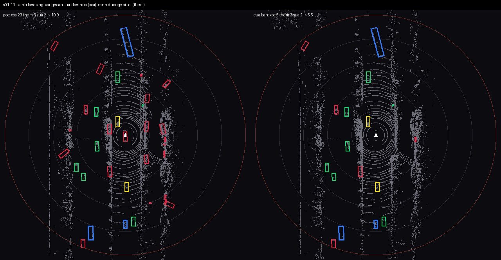

# Báo cáo Day 14 — Phạm Minh Quân — 2A202603307

- Mã học viên dùng với `--student`: `2A202603307`
- `seed_tag` trong `frames_A.txt`: 82ac3100fd

## 1. Dự đoán trước sweep (bước 5b)

Tôi dự đoán tăng `score_thr` sẽ giảm công sửa. Trong tập A, 59/74 hộp cần xóa có score dưới 0,5, còn phần lớn hộp khớp nhãn có score cao. Tuy nhiên, tăng ngưỡng có thể loại cả hộp đúng và làm tăng số vật cần thêm lại.

## 2. Tập A: sửa tay và tune

| Cấu hình | Xóa | Thêm | Sửa | Chi phí |
|---|---:|---:|---:|---:|
| Gốc | 74 | 4 | 4 | 28,2 |
| `best_config.json` | 15 | 6 | 4 | 12,5 |

- Sweep thử 15 tổ hợp của `score_thr` và `min_points`. Cấu hình đã chọn tăng `score_thr` từ 0.1 lên 0.5; `min_points` giữ ở 0, các tham số khác giữ nguyên.
- Kết quả leave-one-out dưới đây được dựng lại từ `sweep.csv` theo cách chọn của `pp_sweep.py`:

```text
s01f11: cấu hình chọn {'score_thr': '0.5', 'min_points': '0'} → 5.5 (tốt nhất có thể 5.5)
s02f40: cấu hình chọn {'score_thr': '0.5', 'min_points': '0'} → 3.5 (tốt nhất có thể 3.5)
s05f36: cấu hình chọn {'score_thr': '0.5', 'min_points': '0'} → 3.5 (tốt nhất có thể 3.5)
```

- Cấu hình được chọn nhất quán trong cả ba lượt leave-one-out và giảm chi phí ở cả ba frame. Với `score_thr=0.5`, cả ba mức `min_points=0,5,10` đều có cùng chi phí 12,5; vì vậy chưa có bằng chứng mức `min_points=0` tốt hơn hai mức còn lại. Cấu hình hiện tại giữ mức mặc định này.

## 3. Trước/sau (bước 8)



- Tổng chi phí tập A giảm từ 28,2 xuống 12,5, tương đương khoảng **55,7%** (làm tròn 56%). Riêng frame `s01f11` trong ảnh, chi phí giảm từ 10,9 xuống 5,5 và số hộp cần xóa giảm từ 23 xuống 5.
- Kết quả phù hợp với dự đoán tăng `score_thr`: tổng số hộp cần xóa giảm từ 74 xuống 15, số hộp cần sửa giữ ở 4. Tuy nhiên, số hộp cần thêm tăng từ 4 lên 6, cho thấy ngưỡng cao cũng loại một số hộp khớp nhãn. Chi phí vẫn giảm vì phần giảm thao tác xóa lớn hơn phần tăng thao tác thêm theo công thức của lab.

## 4. Tập B

Đối chiếu `pred_B.json` với `ref_B.json` theo cách ghép và tính chi phí của lab: đủ 12 frame, 165 hộp dự đoán, 161 hộp tham chiếu và 153 cặp khớp trong phạm vi 50 m.

| Xóa | Thêm | Sửa | Chi phí |
|---:|---:|---:|---:|
| 12 | 8 | 3 | 13,1 |

- Thao tác thêm vật bị sót đóng góp chi phí lớn nhất: 8 điểm, so với 3,6 điểm xóa và 1,5 điểm sửa.
- Theo lớp: cần xóa 7 hộp Cyclist và 5 hộp Car; thêm 4 Car, 3 Truck và 1 Pedestrian; sửa 3 hộp có nhãn tham chiếu Car. Car đóng góp chi phí lớn nhất theo lớp: `5 × 0,3 + 4 × 1 + 3 × 0,5 = 7,0` điểm.
- Có 8/12 frame có chi phí bằng 0 theo các ngưỡng so khớp của script. Kết quả này không tự xác nhận chất lượng nhãn hoặc thay thế việc kiểm từng frame trên CVAT.

## 5. Giới hạn

- Chỉ có 3 frame tune; leave-one-out nhất quán trên A chưa đủ chứng minh cấu hình tổng quát tốt trên các cảnh khác.
- Model học trên KITTI, khác dữ liệu VF và không có lớp Truck/Bus gốc; việc nhận dạng các lớp này dựa vào quy tắc kích thước còn hạn chế.
- Chi phí `0,3 × xóa + 1 × thêm + 0,5 × sửa` là công thức quy ước, chưa đo thời gian thao tác thực tế. Mức giảm 55,7% chỉ là giảm chi phí trên A theo công thức này.
- Nhãn tham chiếu được sửa thủ công và chưa có đánh giá độc lập. Chỉ chấm các vật trong 50 m bằng những ngưỡng ghép/sửa của lab, nên chi phí thấp không bảo đảm mọi hộp đều đúng.
